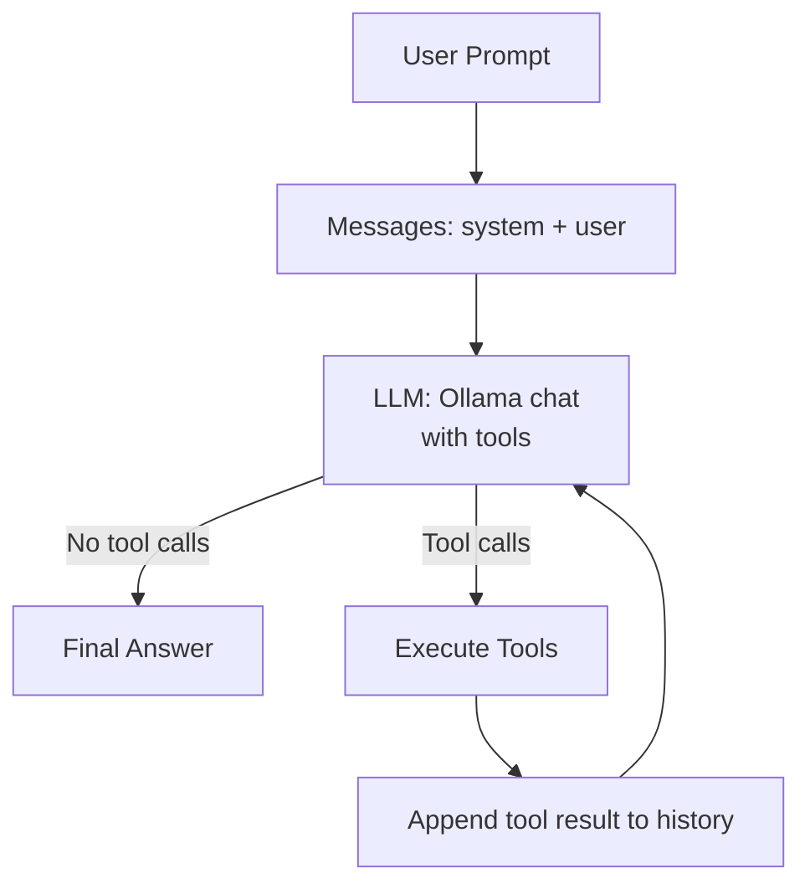

# vanilla-ai-agent

A **vanilla** Python AI agent: a tiny retail assistant that answers questions about sales and warranty — built with **no AI agent framework** at all.

Just Python, [Ollama](https://github.com/ollama/ollama-python), and [SQLite Vector](https://github.com/sqliteai/sqlite-vector).

> No LangChain. No LlamaIndex. No CrewAI. No agent framework. The whole "agent" — the loop that decides when to use a tool, the tool handling, and the data access — lives in a single, readable Python module.

This project is designed both as a small demo and as a teaching example: it shows, line by line, how an AI agent works "under the hood" of any framework you might later use.

## Table of Contents

- [What is this?](#what-is-this)
- [Why "Vanilla"?](#why-vanilla)
- [Architecture](#architecture)
  - [The Agent Loop](#the-agent-loop)
  - [Tools](#tools)
  - [Data Layer](#data-layer)
- [Example Interaction](#example-interaction)
- [Prerequisites](#prerequisites)
- [Setup](#setup)
- [Project Structure](#project-structure)
- [Running](#running)
- [Notes and Limitations](#notes-and-limitations)

## What is this?

`vanilla-ai-agent` is a toy AI assistant for a small online store. Give it a question in plain English, and it will try to answer it:

- *"How many units of the Aura Pro wireless headphones have we sold in total, and what was the revenue?"*
- *"Does the warranty for the Aura Pro Wireless headphones cover accidental water damage?"*
- *"Which product generated the most revenue, and what is its warranty period?"*

Depending on the question, the agent decides whether it can answer directly or whether it needs to **call a tool** to gather information, then answers using the tool's results.

But what is an AI Agent? Here's the short version of what an AI agent is:

1. You give the AI a **goal** (a question or task).
2. The AI has access to **tools** (functions it can call, like a calculator, a database, or a search engine).
3. The AI decides, step by step, whether it needs a tool call to answer.
4. The tool runs, gives the result back to the AI, and the AI uses that result to produce the final answer.

That's the entire "intelligence" of this demo — no magic.

## Why "Vanilla"?

Most AI agent examples you find online wrap this in a framework (LangChain, LlamaIndex, etc.) that handles tool parsing, the tool loop, retries, and memory for you.

This project deliberately skips that. It uses:

- The Python standard library (`sqlite3`, `json`, `importlib`)
- [Ollama](https://github.com/ollama/ollama-python) for LLM chat + embeddings
- [SQLite Vector](https://github.com/sqliteai/sqlite-vector) for vector similarity search

The result is a **fully readable implementation** where you can open `src/agent/main.py` and trace exactly what happens.

## Architecture

### High-level overview



### The Agent Loop

The core of the agent is a simple `while True` loop in `run_agent()`:

1. **Model evaluates** the current message history and decides whether to answer directly or request tool calls.
2. **Append** the assistant's response to the conversation history.
3. **If no tool calls** were requested → print the final answer and stop.
4. **If tool calls were requested** → execute each tool, print the call/response, append the tool result back into the history, and loop again.

```python
while True:
    response = chat(model=MODEL, messages=messages, tools=[...])

    messages.append(response.message)

    if not response.message.tool_calls:
        print(f"\nAgent: {response.message.content}")
        break

    for tool_call in response.message.tool_calls:
        # execute tool -> append result -> loop again
```

This is the essence of an agent: **a model that can use tools, plus a loop that feeds results back until the job is done.**

### Tools

Tools are just regular Python functions, exposed to the model through Ollama's native function/tool-calling support. There is no framework indirection — the function objects are passed directly.

| Tool | Purpose | Implementation |
| --- | --- | --- |
| `query_sales_db` | Run read-only SQL against the sales database (units sold, revenue, etc.) | Wraps a Python function that validates the query starts with `SELECT` and binds parameters safely via `?` placeholders |
| `search_product_docs` | Semantic search over product docs / warranties | Embeds the query with an embedding model, then performs a vector similarity search (cosine distance) via SQLite Vector |

The model decides *which* tool to use and *with what arguments*. In this demo, the system prompt guides it, e.g.:

- Use `query_sales_db` for sales stats / revenue / unit counts.
- Use `search_product_docs` for features / warranties / product knowledge.
- Use `LIKE ? COLLATE NOCASE` with bound parameters for case-insensitive product matching.

### Data Layer

- **SQLite sales database** (`store.db`) with a `sales` table: `product_name`, `category`, `units_sold`, `unit_price`, `sale_date`.
- **SQLite vector store** via the `sqlite_vector` extension, with a `product_docs` table containing text + embeddings.
- On startup, `init_mock_data()` seeds the database with sample sales and product documentation.

## Example Interaction

The full loop, as a user would experience it:

```bash
% uv run agent
Hello from your vanilla AI agent!

User: How many units of the Aura Pro wireless headphones have we sold in total, and what was the revenue?
  [Tool Call] -> query_sales_db({'sql_query': 'SELECT SUM(units_sold) AS total_units, SUM(units_sold * unit_price) AS total_revenue FROM sales WHERE product_name LIKE ? COLLATE NOCASE', 'parameters': ['Aura Pro wireless headphones%']})
  [Tool Response] -> tool_output='[{"total_units": 205, "total_revenue": 40997.950000000004}]'

Agent: We have sold a total of **205 units** of the Aura Pro wireless headphones, generating a total revenue of **$40,997.95**.
----------------------------------------

User: Does the warranty for the Aura Pro Wireless headphones cover accidental water damage?
  [Tool Call] -> search_product_docs({'query': 'warranty coverage for accidental water damage for Aura Pro Wireless headphones', 'top_k': 1})
  [Tool Response] -> tool_output='[{"content": "Aura Pro Wireless Headphones: Features active noise cancellation and 40-hour battery life. Warranty: 2 years limited warranty covering battery degradation and hardware defects. Accidental water damage is not covered.", "distance": 0.24182218313217163}]'

Agent: No, the warranty for the Aura Pro Wireless headphones does not cover accidental water damage. The warranty is limited to 2 years and covers battery degradation and hardware defects.
----------------------------------------

User: Which product generated the most revenue, and what is its warranty period?
  [Tool Call] -> query_sales_db({'sql_query': 'SELECT product_name FROM sales GROUP BY product_name ORDER BY SUM(units_sold * unit_price) DESC LIMIT 1'})
  [Tool Response] -> tool_output='[{"product_name": "Aura Pro Wireless Headphones"}]'
  [Tool Call] -> search_product_docs({'query': 'warranty period for Aura Pro Wireless Headphones', 'top_k': 1})
  [Tool Response] -> tool_output='[{"content": "Aura Pro Wireless Headphones: Features active noise cancellation and 40-hour battery life. Warranty: 2 years limited warranty covering battery degradation and hardware defects. Accidental water damage is not covered.", "distance": 0.20142430067062378}]'

Agent: The product that generated the most revenue is the **Aura Pro Wireless Headphones**.

Its warranty period is a **2-year limited warranty**, covering battery degradation and hardware defects. Please note that accidental water damage is not covered under this warranty.
```

Notice the pattern:

- The user asks a question.
- The agent calls the right tool(s).
- The tool result comes back.
- The agent synthesizes a final answer.

## Prerequisites

- [Python 3.15](https://www.python.org)
- [uv](https://docs.astral.sh/uv/) (package manager)
- [Ollama](https://github.com/ollama/ollama) running locally (`ollama serve`)
- The Ollama models:
  - `gemma4:e2b-mlx` (chat model — note: may generate incomplete SQL queries due to being a small model)
  - `embeddinggemma-2:270m` (embedding model for vector search)

## Setup

```bash
uv sync
```

## Project Structure

```
vanilla-ai-agent/
├── README.md
├── pyproject.toml
├── store.db                  # SQLite sales + vector database (auto-seeded)
└── src/agent/
    ├── __init__.py           # Entry point (`agent` console script)
    └── main.py               # Everything: data, tools, agent loop, demo prompts
```

## Running

```bash
uv run agent
```

## Notes and Limitations

- The chat model (`gemma4:e2b-mlx`) is small and may occasionally generate incomplete SQL queries — this is flagged in the code.
- The `query_sales_db` tool only allows read-only `SELECT` statements; all user values are bound via parameterized placeholders, never interpolated into SQL.
- The demo uses mock data and hardcoded test prompts.
